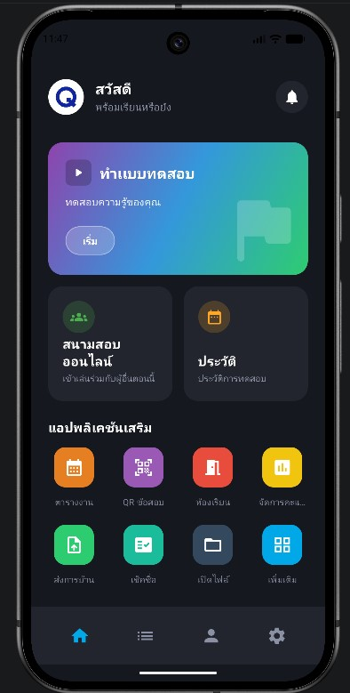
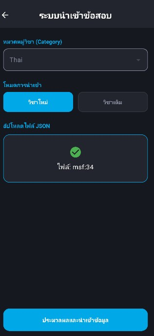
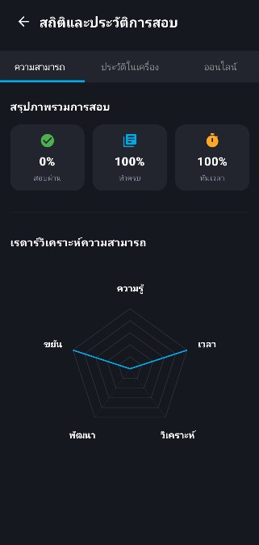

# Q-Exalize / Q-Growth

Q-Exalize is an Android learning and assessment app built with Kotlin and Jetpack Compose. The Android application is branded **Q-Growth** and helps learners create, import, take, and review quizzes from one place.

## Screenshots

| Dashboard | Import quiz | Learning statistics |
| --- | --- | --- |
|  |  |  |

## Highlights

- Create categories, courses, and question banks
- Import and export quizzes as JSON
- Timed exams with configurable pass criteria and question randomization
- Review answers, explanations, results, and learning history
- Anti-cheat controls for app switching and screenshots
- Local persistence with Room
- Optional Firebase features for classrooms, sharing, and online activities
- QR scanning, schedules, grade tools, homework, and learning mini-games
- Thai and English interface resources

## Repository layout

- `android-app/` — complete Android Studio project
- `editor.html` — browser-based JSON quiz editor
- `index.html` — privacy policy page

## Run the Android app

Requirements:

- Android Studio with JDK 17
- Android SDK 35
- An emulator or Android device running Android 7.0 (API 24) or newer

Open `android-app` in Android Studio, allow Gradle to sync, then run the `app` configuration.

The public source builds without private Firebase configuration. To enable Firebase-backed features, create your own Firebase Android project for package `com.qgrowth.app` and place its `google-services.json` in `android-app/app/`. Never commit that file, signing keys, or `local.properties`.

From a terminal on Windows:

```powershell
cd android-app
.\gradlew.bat assembleDebug
```

## Quiz JSON editor

Open `editor.html` in a modern browser. The editor stores draft metadata and questions in browser local storage and exports a JSON file compatible with the app.

## Privacy and public-source safety

This repository excludes Firebase credentials, signing material, machine-specific SDK paths, packaged APK/AAB files, build outputs, and real user quiz data. Sample or personal question banks are not included.

## Technology

Kotlin, Jetpack Compose, Room, WorkManager, ZXing, Gson, Firebase SDK, and Google Play Billing.

## License

All rights reserved. This repository is published as a portfolio project. Contact the repository owner before reusing application assets or source code.
